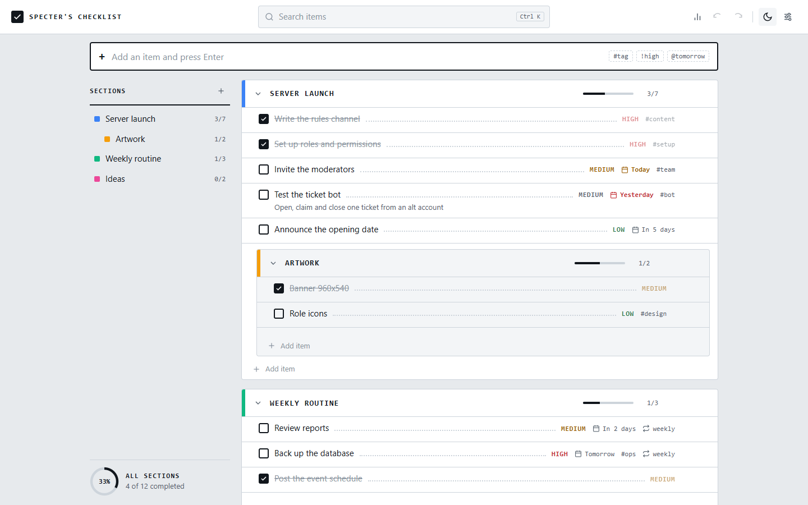
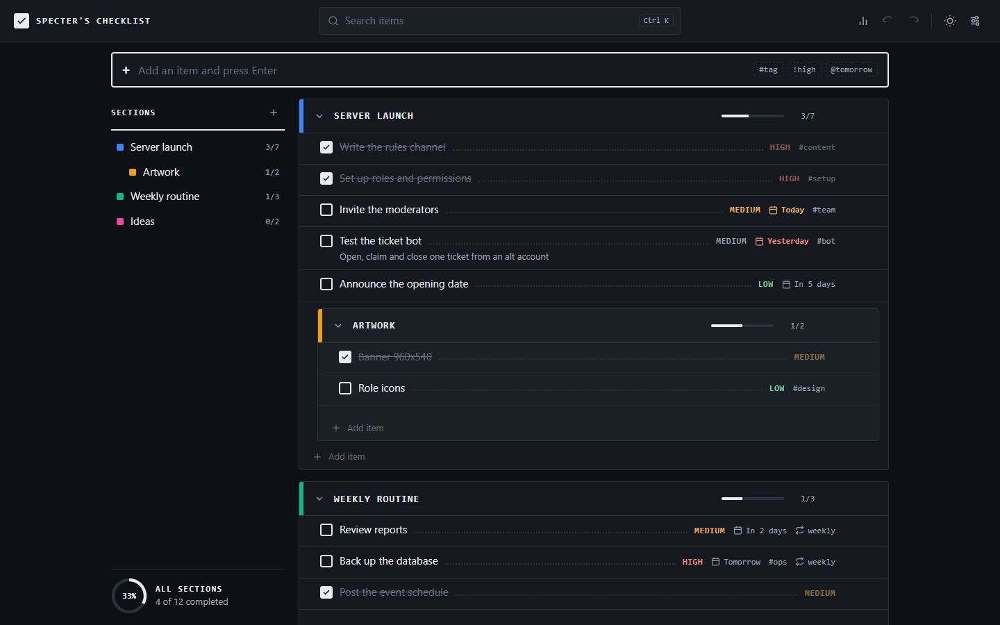

# Specter's Checklist

A checklist app that runs in the browser. There is no server and no account: open `index.html` and your lists are saved in the browser's own storage.



## What it does

- Sections inside sections, each with its own colour and progress count.
- Items with a priority, tags, a due date, notes and an optional daily, weekly or monthly repeat.
- Quick add with shorthand. `Back up the database #ops !high @tomorrow` sets the tag, the priority and the due date in one line.
- Drag items to reorder them or move them to another section.
- Undo and redo for every change.
- Search, plus a command palette on Ctrl+K for every action.
- Statistics: completion, streak, and the last seven days.
- Export to JSON or Markdown, import from JSON.
- Light and dark themes.



## Running it

Download the folder and open `index.html` in a browser. Nothing needs to be installed or built.

## Shortcuts

| Key | Action |
| --- | --- |
| N | New item |
| S | New section |
| Ctrl+K | Command palette |
| Ctrl+F | Search |
| Ctrl+Z / Ctrl+Y | Undo / redo |
| D | Light or dark theme |
| Up / Down | Move between items |
| Enter | Tick the selected item |
| E | Edit the selected item |
| Delete | Delete the selected item |

Right-click an item or a section for the rest: edit, move, duplicate, set a date or priority, turn an item into a section.

## Your data

Everything is stored in `localStorage` in the browser you use, under keys starting with `specter_checklist_`. It never leaves your computer. Clearing the browser's site data removes it, so export a JSON backup now and then.

## Layout

```
index.html         the page
css/styles.css     all styling, light and dark
js/data.js         storage, dates, sections, items, undo history
js/components.js   icons, toasts, dialogs, menus, HTML for sections and items
js/features.js     drag and drop, shortcuts, search, command palette, quick-add parsing
js/app.js          wires the page together
```

Plain HTML, CSS and JavaScript with no dependencies.

## License

MIT, see [LICENSE](LICENSE).

Haider Alowlaqi, aka King Specter · ceo@specters.group · haider.alowlaqi@gmail.com · Discord: 9king
